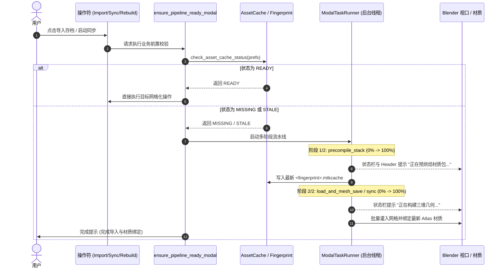

# MoziToolKit 生产级动画资产、按需预烘焙与原版特性演进技术规范

本文档系统性定义了 `MoziToolKit` 迈向工业级 Minecraft 动画制作资产生产力工具的核心架构设计、数据契约与交互演进规范。

---

## 1. 架构定位与生产级目标

在完成基础 Minecraft 存档 700ms 极速网格化导入与 Blender 5.0+ 零拷贝属性直写通道后，插件的核心演进目标是：**从“仅能导入地形方块”跨越至“一键导入即可用于 Cycles/Eevee 动画级布景与角色/道具交互”的生产级 DCC 工具**。

### 核心设计原则
1. **无感前置就绪 (Zero-Friction Readiness)**：用户配置材质包后，任何网格构建操作均由系统自动保证依赖资产已烘焙且最新，消灭白模与报错。
2. **真实原版保真 (Vanilla Fidelity)**：1:1 还原原版生态色彩（群系采样与平滑渐变）与悬挂/装饰图元（画、展示框、地图、告示牌文字）。
3. **动画师友好装配 (Animation-Ready Hierarchy)**：区分静态地形与可动部件（门、箱子盖、钟体），为可交互部件保留精确物理铰链轴心（Pivot Point）。

---

## 2. 胶水层智能按需预烘焙门禁规范 (`On-Demand Prebake Pipeline`)

### 2.1 痛点与现有断层
* **现状**：用户在偏好设置中指定了资源包目录后，若未手动点击“预编译缓存”，或者更新资源包后指纹过期，导入世界或启动同步时由于 `get_world_pipeline_assets()` 返回 `None`，网格化器被迫回退至无 UV 占位模式，导致场景产生无贴图灰模。
* **目标**：彻底消除“必须先手动预烘焙”的心智负担，由胶水层在发起任何构建前执行自动门禁校验。

### 2.2 状态判定模型
```python
class AssetCacheStatus(Enum):
    READY = "ready"      # 缓存存在，版本匹配，且指纹与当前资源包栈完全一致
    MISSING = "missing"  # 从未生成过 .mtkcache 缓存文件
    STALE = "stale"      # 存在历史缓存，但资源包路径/内容已变动，指纹不匹配
```

### 2.3 模态两阶段异步任务流时序


---

## 3. 真实 3D 生物群系 Tint 采样与平滑过渡规范 (`True Biome Tint & Blend`)

### 3.1 现状与问题
`SectionMesher` 中的 `compute_face_tint` 当前临时写死了全局平原（`plains`）调色板回退。导致沼泽深灰绿水体、热带雨林高饱和翠绿、恶地枯黄草木等原版独特视觉在导入后丢失。

### 3.2 3D Quart Biome 空间索引
Minecraft 1.18+ 采用 4×4×4 方块为一个 Quart 的三维体素群系存储。
* 对于方块局部坐标 `(lx, ly, lz) ∈ [0, 15]`，Quart 坐标为：
  $$qx = \lfloor lx / 4 \rfloor, \quad qy = \lfloor ly / 4 \rfloor, \quad qz = \lfloor lz / 4 \rfloor$$
* `SectionBiomes` 依据 64 个 Quart 调色板索引精确解出该体素所属的权威 Biome ID。

### 3.3 5×5 (R=2) 水平生物群系平滑混合（Biome Blend）
为了避免相邻区块或群系交界处出现突兀的色彩折线，针对草方块顶面、树叶与水面，启用 5×5 窗口加权均值混合：
$$\mathbf{C}_{\text{blended}}(x, z) = \frac{1}{\sum w_{i,j}} \sum_{i=-2}^{2} \sum_{j=-2}^{2} w_{i,j} \cdot \mathbf{C}_{\text{biome}}(x+i, z+j)$$
* 权重矩阵 $w_{i,j}$ 采用原版径向二次衰减权重；
* 双层水面在着色器节点树中根据深度自动混合水面颜色与水下雾气吸收系数。

---

## 4. 原版静态悬挂实体与地图数据管线 (`Static Entities & Filled Map`)

### 4.1 独立实体文件读取与过滤
* **数据来源**：Minecraft 1.17+ 独立实体区域文件（`entities/r.X.Z.mca`），兼容旧版 Chunk NBT 内嵌 `Entities` 标签；
* **空间裁剪**：遍历实体 Compound，提取 `Pos: [Double, Double, Double]`，仅保留落入用户选区 AABB 内的实体。

### 4.2 艺术画 (Painting) 规范
* **标签解析**：`variant`（画作名称）、`facing`（水平朝向 0:S, 1:W, 2:N, 3:E）与 `Pos`；
* **规格查找表 (Dimensions Catalog)**：
  | 规格 | 典型画作名称 |
  | :--- | :--- |
  | **1×1 (16×16)** | `kebab`, `aztec`, `alban`, `bomb`, `plant`, `wasteland` |
  | **2×1 (32×16)** | `pool`, `courbet`, `sea`, `sunset`, `creebet` |
  | **1×2 (16×32)** | `wanderer`, `graham` |
  | **2×2 (32×32)** | `match`, `bust`, `stage`, `void`, `skull_and_roses`, `wither` |
  | **4×2 (64×32)** | `fighters` |
  | **4×3 (64×48)** | `skeleton`, `donkey_kong` |
  | **4×4 (64×64)** | `pointer`, `pigscene`, `burning_skull` |
* **几何拓扑生成**：生成带 1/16 方块厚度的木框边缘、微凹陷画面主网格与木背板，背面自动剔除或贴上原版 `painting/back.png`。

### 4.3 物品展示框 (Item Frame & Glow Item Frame) 规范
* **标签解析**：`TileX, TileY, TileZ`、`Facing`（0:下, 1:上, 2:北, 3:南, 4:西, 5:东）、`ItemRotation`（0..7，每次 45°）、`Invisible`（布景常用隐形框）；
* **自适应内容物装配**：
  * **内含方块**：将方块模型等比缩减至 0.5 倍，旋转 45° 居中嵌入框内；
  * **内含普通物品**：生成自适应像素切分并带 0.5 像素挤出厚度的 Flat 3D 物品几何，依据 `ItemRotation` 旋转；
  * **内含地图 (`filled_map`)**：展示框外壳自动隐藏，地图扩展为 1×1 方块正方形全覆盖薄片。

### 4.4 填充地图数据 (Filled Map Data) 解码
* **数据路径**：存档目录 `data/map_<id>.dat`（Gzip 压缩 NBT）；
* **调色板解码算法**：
  * 读取 `colors: [Byte; 16384]`（对应 $128 \times 128$ 像素）；
  * 每个字节高 6 位为 `color_id`（对应原版 60+ 种 `MapColor` 基础色彩），低 2 位为 `shade_id`（明暗乘数：0: 180/255, 1: 220/255, 2: 255/255, 3: 135/255）；
  * Rust 核心快速解码为连续 RGBA8 像素缓冲（$128 \times 128 \times 4$ 字节）；
  * Blender 前端通过 `bpy.data.images.new` 创建临时内存图像，赋予展示框无缝贴图材质。

---

## 5. CTM 连接纹理端到端打通与测试规范 (`CTM Pipeline`)

### 5.1 链路闭环设计
1. **预烘焙扫描 (`mtk-resource`)**：扫描资源包活跃栈中的 `assets/*/optifine/ctm/` 与 `continuity/` 规则文件（`.properties`）；
2. **图集扩展装箱 (`mtk-texture`)**：将 CTM 引用的全部子切片纹理（0~46.png）编入 Atlas 装箱列表并记录其 Atlas UV 偏移；
3. **缓存打包 (`libmtk::prebake`)**：将解析构建好的 `CtmSolver` 序列化写入 `.mtkcache` 的自定义 Chunk 中；
4. **网格化求解 (`mtk-voxel`)**：在 `SectionMesher` 网格化时，根据相邻体素的 BlockState 求解 CTM 47 / Compact 5 连接索引，直接输出对应切片的 Atlas UV；
5. **测试门禁 (`mtk-testkit`)**：引入标准无缝玻璃（Connected Glass）与连续书架测试夹具，构建自动化端到端测试，验证跨区块边界连接与面遮挡协同。

---

## 6. 复杂方块实体图元与动画铰链装配规范 (`BER & Animation Rigging`)

### 6.1 告示牌与悬挂告示牌文字 (Sign Text)
* 解析 `front_text` / `back_text` 中的 JSON 文本成分（`messages`）；
* 提取文字颜色（16 种染料）、`has_glowing_text`（发光墨囊属性）；
* 在木质告示牌表面生成自发光矢量排版网格或烘焙纹理图层，接入 Emissive 自发光材质通道。

### 6.2 旗帜多层花纹合成 (Banner Patterns)
* 读取 NBT `patterns` 列表（`pattern`: 花纹类型标识符，`color`: 染料颜色编号 0..15）；
* 按原版 40+ 种标准花纹图层模板，自底向上执行多层 Alpha 图像混合，合成独立 64×64 旗面纹理。

### 6.3 动画友好分体装配与物理轴心 (Animation Rigging Hierarchy)
在导入设置中增加“**保留可交互部件分体 (Keep Animatable Parts)**”选项：
* **门 (Doors)** 与 **栅栏门 (Fence Gates)**：门体独立为子物体，旋转轴心（Pivot Point）精准对齐合页侧边缘；
* **箱子 (Chests)**：箱盖（Lid）与铰链独立为子物体，旋转轴心精确对齐后部合页缝；
* **钟 (Bells)**：钟体独立为子物体，旋转轴心对齐顶部挂梁中心。
导入后，动画师可直接对子物体打关键帧制作平滑推门、开箱与敲钟动画。
