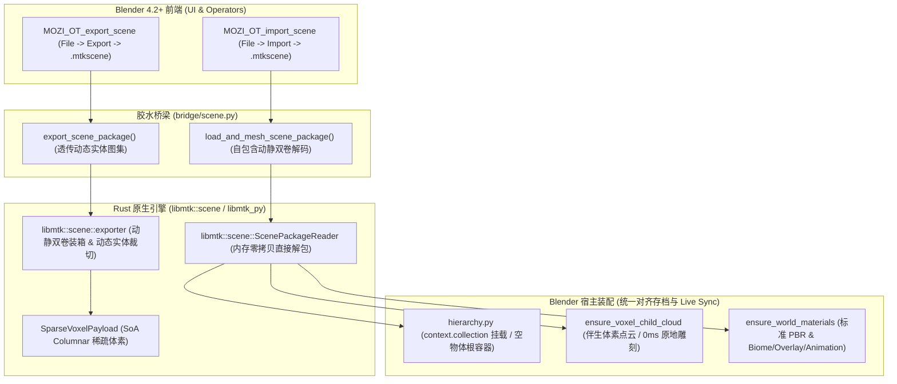

# MTK 场景交换格式与自包含世界胶囊规范 (.mtkscene)

本文档是 `MoziToolKit` 中关于 **MTK 场景交换包 (`.mtkscene`)** 的端到端设计体系、架构规约、核心技术突破与 Blender DCC 交互手册。

---

## 1. 设计哲学与核心理念：自包含世界胶囊 (Self-Contained World Capsule)

在传统的体素与 DCC 交互管线中，中间场景格式往往面临严重的**“异类格式分裂”**：
1. **传统 3D 格式的“几何爆炸”**：导出为 OBJ/USD/FBX/glTF 会生成数百万个静态多边形面和固化的 UV/AO，文件动辄数百 MB，丢失了体素的连续拓扑与动态邻域信息；
2. **外部资源强耦合**：直接分享 `.mca` 存档或常规选区文件要求接收方必须具备完全一致的 Minecraft 客户端版本、材质包与 Mod 环境；
3. **旧版 `.mtkscene` 的“异类隔离”缺陷**：早期版本将 `.mtkscene` 当作异类渲染资产，在单独的集合（`MoziToolKit_Scenes`）中孤立创建网格，使用独立的简易材质节点树，导致**动态实体材质缺失（0xFFF0 槽位越界紫黑粉）**、**UV 坐标顶置反转**、**丢失长条动画与双层覆层 (Overlay)** 以及**无法享受生物群系调色板与原地体素雕刻**。

### 统一世界胶囊范式
在本次重大重构中，**`.mtkscene` 不再被视为一个“异类格式”，而是被定义为一个“自包含的体素世界来源 (Self-Contained Voxel World Capsule)”**：
- **概念对齐**：它就像一个将原版存档、Tree-Shaken 模型库、微缩图集（Mini-Atlas）与动态实体纹理完美压缩打包的便携胶囊；
- **地位对齐**：导入 Blender DCC 时，它享受与 **Minecraft 原版存档导入 (Save Import)** 及 **Live Sync 实时同步** 100% 相同的第一等公民待遇；
- **全链路一致**：挂载于当前激活集合（`context.collection`），继承统一空物体根容器体系，绑定伴生体素点云（Companion Voxel Cloud），并接入标准预解码 PBR 材质与生物群系单一事实源（SSOT）。

---

## 2. 架构拓扑与交互管线

场景交换功能遵循 MoziToolKit 的严苛架构边界：
- **底层原生计算 (`libmtk::scene`)**：纯 Rust 实现体素打包、模型树剪枝、Mini-Atlas 贴图裁剪装箱、动态实体平民化与 UV 重映射，纯 Data-In, Data-Out，宿主无关；
- **跨语言纯数据桥 (`bridge/scene.py`)**：负责 Python 与 Rust 之间的强类型连续缓冲及内存流交换，严禁渗透任何 Blender 专有业务；
- **宿主层级与业务装配 (`utils/scene/` & `utils/materials/`)**：统一调用 `ensure_world_materials` 构建标准 Principled BSDF，装配统一根容器，创建伴生点云与属性驱动；
- **Blender 交互与菜单 (`operators/scene/`)**：集成于 Blender 主菜单 `File -> Export` 与 `File -> Import`。



---

## 3. 关键机制与核心技术突破

### 3.1 底置左下 UV 坐标数学修正 (Bottom-Left UV Math)
- **痛点分析**：PNG/图像像素存储以左上角（Top-Left, $Y=0$ 在顶部）为原点，而 3D DCC（Blender/OpenGL）UV 纹理坐标系以左下角（Bottom-Left, $V=0$ 在底部）为原点。旧版计算直接使用顶置归一化，导致 Mini-Atlas 裁切后的 UV 坐标上下倒置，图元在网格上颠倒错位。
- **精确解法**：在 Rust 导出器 (`exporter.rs`) 中重构 UV 投影数学：
  $$v_{\min} = 1.0 - \frac{y + h}{H}, \quad v_{\max} = 1.0 - \frac{y}{H}$$
  将源图集矩形区域精确转换至 3D 空间的规范左下原点，彻底根治颠倒问题。

### 3.2 动静双卷 Mini-Atlas (Dual-Volume Mini-Atlas)
- **动静双卷架构**：
  - **Static Volume (`scene_atlas_xxx.png`)**：包含场景所有用到的静态方块贴图，以及动态方块的**第 0 帧**（静态安全回退帧）；
  - **Animated Volume (`scene_anim_atlas_xxx.png`)**：若场景中检测到动态序列帧（如海晶灯、熔炉火焰、水流、烟气等），导出器将自动生成垂直排列的完整长条序列帧（Strip Rect），并在包头元数据中标记 `has_animated_atlas = true`；
- **按需自由切换**：用户在 Blender 导入操作符中可自由勾选 `enable_animated_textures`，无需在导出端重新烘焙，实现动态/静态场景一键随心切换。

### 3.3 原生流体贴图防御 (Fluid Defense)
- **痛点分析**：Minecraft 水（Water）和岩浆（Lava）常由引擎底层特化的流体渲染器生成，其标准方块模型 JSON 可能不包含完整的材质贴图纹理声明。在旧版 Mini-Atlas 模型剪枝中，流体贴图经常被误剔除，导致流体方块导入后因缺少纹理而失效。
- **主动防御机制**：导出器在扫描 `state_palette` 时，一旦探测到包含 `minecraft:water`、`minecraft:flowing_water`、`minecraft:lava` 或 `minecraft:flowing_lava` 等流体状态，主动防御机制立即触发，将原版权威流体纹理（`water_still`, `water_flow`, `lava_still`, `lava_flow`）强制编入 Mini-Atlas 贴图池，确保 100% 具备有效贴图。

### 3.4 动态实体平民化装箱 (Dynamic Entity Democratization)
- **痛点分析**：在 Live Sync 或原版存档中，玩家头颅（Player Heads）与旗帜（Banners）属于动态实体贴图，其材质索引被特殊编码为 `0xFFF0` 等扩展区间，依赖外部运行时的动态实体图集（`MTK_Dynamic_Entities_Atlas`）。直接导出为普通场景包后，由于缺乏该图集，面上的 `0xFFF0` 材质索引直接发生 Blender 材质槽位越界，表现为丢图粉色。
- **平民化裁切装箱**：
  1. 导出器接收 Blender 场景中提取的 `dynamic_entity_atlases` 内存图集；
  2. 自动定位该体素选区引用的 64x64 玩家皮肤头颅与旗帜图案；
  3. 将它们以**标准静态图元**的身份并入首个 Mini-Atlas Chunk（Slot 0）；
  4. 自动重映射这些方块模型的面材质索引为 Slot 0，生成完全标准化的自包含模型。
  此举彻底消除了对外部动态图集的硬依赖，解包即可开箱即用。

### 3.5 双层贴图与生物群系单一事实源 (Dual-Layer Overlay & Biome Tint SSOT)
- **双层覆盖层 (Overlay)**：针对草方块侧面（Grass Block Side Overlay）、高炉发光纹理等原版复合图层，导出器提取并装箱伴生 `{stem}_overlay.png`，并在映射中标记 `has_overlay = true`；
- **标准预解码材质管线**：导入装配统一由 `ensure_world_materials` 执行，自动构建标准 Principled BSDF + 属性向量化驱动：
  - `mtk_biome_tint` 属性驱动草方块与树叶生物群系色彩；
  - `mtk_water_tint` 属性驱动水体颜色；
  - Overlay 节点分支进行正确的 Alpha 混合。

### 3.6 统一世界空物体根容器 (Unified World Empty Container)
- **拒绝专属集合分裂**：彻底废弃旧版建立 `MoziToolKit_Scenes` 集合的做法，所有导入的物体直接挂载在用户当前的 `context.collection` 下；
- **层级拓扑规范**：
  ```text
  [Scene] <SceneName>                (Empty 容器, mtk:is_container=True, mtk:container_type="SCENE")
  ├── [Scene] <SceneName>_Mesh       (几何网格, mtk:is_scene_mesh=True, mtk:geometry_origin="SCENE")
  └── [Scene] <SceneName>_VoxelCloud (伴生点云, mtk:is_voxel_cloud=True, 默认视口隐藏)
  ```
- **伴生体素点云连续性**：点云数据同步注入 `register_object_storage`，使得用户导入场景后，可直接在 DCC 中进行体素雕刻、无损重新网格化（Remesh）或参与随后的 Live Sync。

---

## 4. 纯数据桥梁接口 (`bridge/scene.py`)

- **`inspect_scene_package(path: str) -> Dict[str, Any]`**：
  零解压开销读取包头，返回元数据字典（体素总数、包围盒、尺寸、是否含动画图集等）。
- **`read_scene_package(path: str) -> Dict[str, Any]`**：
  读取场景包全量结构（点云、烘焙模型库、图集描述符、映射表与元数据）。
- **`load_and_mesh_scene_package(path: str, prefs, enable_animated_textures: bool = True, ...) -> Dict[str, Any]`**：
  高级无头编排接口：直接将场景包体素还原为 `VoxelStorage` 并调用底层原生网格化引擎，生成多边形 `mesh_data` 与伴生体素点云。
- **`export_scene_package(output_path: str, point_cloud, prefs, dynamic_entity_atlases=None, ...) -> Dict[str, Any]`**：
  从选定点云中提取有效体素，结合全局缓存与动态实体图集，装箱生成标准自包含 `.mtkscene` 文件。

---

## 5. 操作符与用户交互手册

| 操作符标识 | UI 菜单路径 | 说明 |
| :--- | :--- | :--- |
| **`mozi.export_scene`** | `File -> Export -> MTK Scene Interchange (.mtkscene)` | 选中场景内任意包含伴生点云的网格物体，导出便携自包含场景包。 |
| **`mozi.import_scene`** | `File -> Import -> MTK Scene Interchange (.mtkscene)` | 弹出包含“场景胶囊信息”、“网格化与着色器”、“坐标定位”等完整面板的文件导入对话框。 |

### 导入参数面板 (`MOZI_OT_import_scene`)
- **Enable Animated Textures**：是否启用动画长条图集（开箱支持海晶灯、熔炉、传送门动态帧）；
- **Enable Smooth Ambient Occlusion**：是否启用平滑环境光遮蔽（Smoothed AO）；
- **Mesh Fluid Surfaces**：是否生成流体曲面（水、岩浆）；
- **Weld Vertices**：是否缝合共面顶点以降低多边形数量；
- **Center at World Origin**：是否将选区几何中心自动对齐至 Blender 场景原点 (0, 0, 0)。
