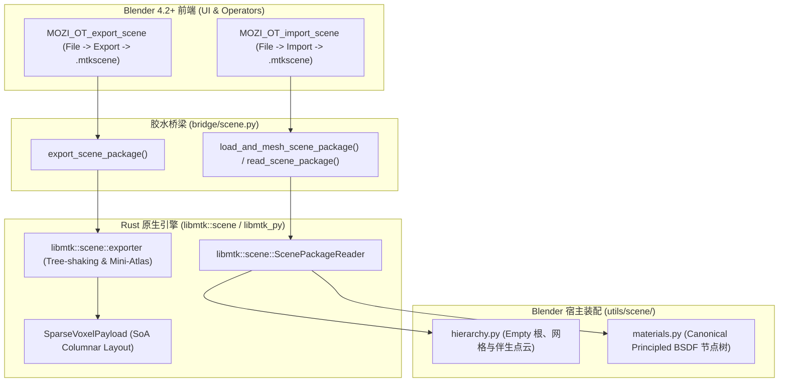

# MTK 场景交换格式与自包含场景包规范 (.mtkscene)

本文档是 `MoziToolKit` 中关于 **MTK 场景交换包 (`.mtkscene`)** 的端到端设计、管线架构与 Blender DCC 交互手册。

---

## 1. 设计背景与核心价值

在 Minecraft 3D 创作流中，传统的选区导出通常面临两难困境：
1. **传统 3D 格式的“几何爆炸”**：导出为 OBJ/USD/FBX/glTF 会生成数百万个静态多边形面和固化的 UV/AO，文件动辄数百 MB，无法按需调整面剔除或材质管线；
2. **原版存档强依赖**：直接分享 `.mca` 或原版存档需要接收方具备完全一致的 Minecraft 客户端、材质包和 Mod 环境，且需要重新遍历数十 GB 的区域文件进行坐标框选。

### 核心解法：`.mtkscene` 场景交换格式
- **紧凑稀疏体素 (Sparse Voxel SoA Layout)**：仅存储选区内的有效表面体素（结合伴生体素点云），体积通常仅 **500 KB ~ 15 MB**，压缩比极高。
- **自包含 Mini-Atlas (Tree-Shaken Mini-Atlas)**：导出时自动扫描体素引用的方块模型与材质贴图，从全局资产缓存中裁剪出仅供该场景使用的微型多通道 PBR 图集，并自动完成模型 UV 并行重映射。
- **Tree-Shaken 模型库**：仅打包场景实际用到的方块模型定义 (`BakedModelDatabase`)。
- **脱离原版客户端独立运行**：接收方无需配置 Minecraft 原版 JAR 或材质包，即可 100% 还原高精度几何与规范 Principled BSDF 材质。

---

## 2. 架构拓扑与交互管线

场景交换功能遵循 MoziToolKit 的严苛架构边界：
- **核心计算与编解码**：由底层的 `libmozitoolkit` (`libmtk::scene`) 纯 Rust 实现，完成体素打包、模型树剪枝、Mini-Atlas 贴图裁剪与 UV 重映射。
- **纯数据桥梁**：由 `bridge/scene.py` 承载，提供 Data-In, Data-Out 接口，严禁内嵌宿主专有状态。
- **宿主业务装配**：由 `utils/scene/hierarchy.py` 与 `utils/scene/materials.py` 负责 Empty 容器、伴生体素点云与 Principled BSDF 材质节点树构建。
- **操作符与 UI 挂载**：由 `operators/scene/` 实现，分别挂载在 Blender 主菜单 `File -> Export` 与 `File -> Import`。

---

## 3. 核心接口与数据流

### 3.1 纯数据桥梁 (`bridge/scene.py`)

- **`inspect_scene_package(path)`**：
  快速读取 `.mtkscene` 包头与 `META` chunk，返回包含 `bounds`, `voxel_count`, `atlas_resolution`, `generator`, `created_at` 的元数据字典，零内存解压开销。
- **`read_scene_package(path)`**：
  读取场景包全量数据，返回 `point_cloud` (`VoxelPointCloud`), `models` (`BakedModelDatabase`), `atlas` (`BakedAtlas`), `atlas_mapping_json` 及 `metadata`。
- **`load_and_mesh_scene_package(path, ...)`**：
  无头高层编排接口：解析包后自动还原 `VoxelStorage`，并直接调用底层 `mesh_voxel_storage` 进行网格化，输出 `mesh_data` 与伴生体素点云。
- **`export_scene_package(output_path, point_cloud, prefs, ...)`**：
  从 DCC 场景中的活跃 `VoxelPointCloud` 提取体素，结合本地激活的 `.mtkcache` 资产缓存进行模型裁剪与 Mini-Atlas 拼接，导出单一 `.mtkscene` 文件。

### 3.2 宿主业务装配 (`utils/scene/`)

- **`apply_imported_scene_to_blender(scene_data, ...)`**：
  1. 创建规范的 Empty 根容器物体（标识属性 `mtk:is_save_root = True`, `mtk:origin = "SCENE"`）；
  2. 创建几何网格物体并挂载（支持 DNA 直写极速通道与官方 `foreach_set` 安全通道）；
  3. 挂载伴生体素点云（`mtk:is_voxel_cloud = True`），为用户提供后续原地刷新、雕刻与实时同步支持；
  4. 自动生成并绑定自包含 PBR 材质（规范 Principled BSDF + Standard MixRGBA 节点树）。

---

## 4. 操作符与菜单集成

| 操作符标识 | UI 名称 | 挂载位置 | 快捷说明 |
| :--- | :--- | :--- | :--- |
| **`mozi.export_scene`** | `MTK Scene Interchange (.mtkscene)` | `File -> Export` (文件导出菜单) | 选中国内任意包含伴生点云的网格物体即可导出自包含交换包 |
| **`mozi.import_scene`** | `MTK Scene Interchange (.mtkscene)` | `File -> Import` (文件导入菜单) | 一键选取 `.mtkscene` 文件，自动完成体素重构、材质绑定与层级装配 |

---

## 5. 技术约束与规范对齐

1. **零假数据与错误透传**：导出时若缺少激活的 `.mtkcache`，抛出明确错误并引导用户配置，杜绝静默生成灰模；
2. **伴生体素点云连续性**：导入生成的几何网格严格遵循规则 8，通过 `mtk:is_voxel_cloud` 建立 0ms 伴生关联；
3. **Blender 4.2+ 现代标准**：材质节点树严禁使用废弃的 `ShaderNodeMixRGB` 与 `mat.use_nodes = True`，严格使用 `ShaderNodeMix` 与现代接口。
